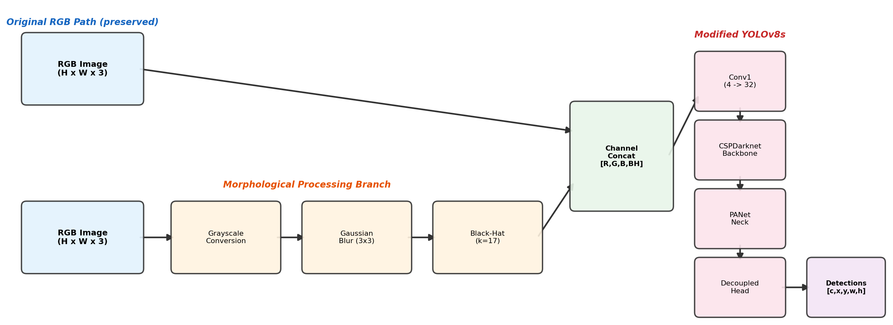
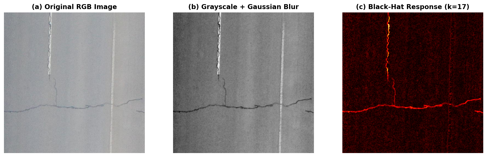
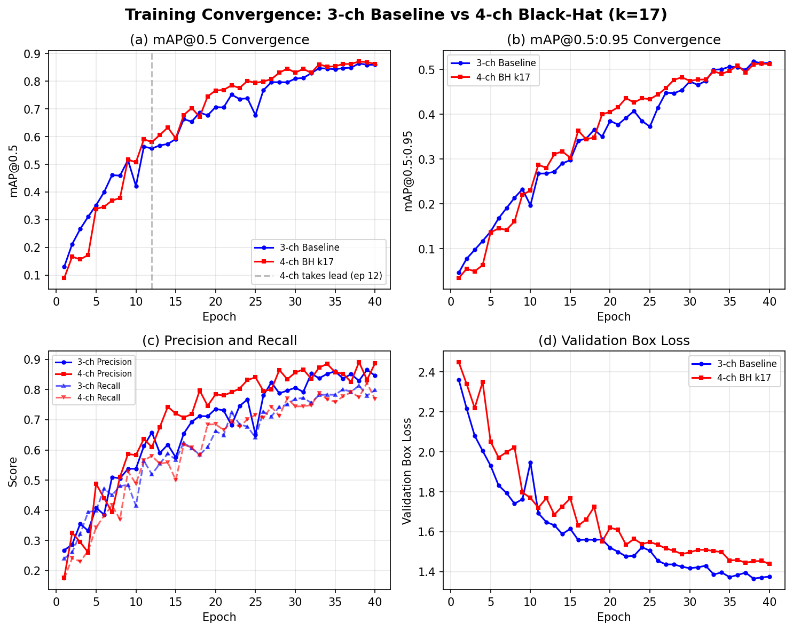

# Road Damage Detection with YOLOv8 and Morphological Features

This project accompanies the unpublished project paper, *Morphological
Attention-Guided Early Fusion for Road Damage Detection and Classification
Using YOLOv8*. It evaluates whether a black-hat morphological prior helps
YOLOv8s detect road damage in RDD2022 imagery. The repository provides a
reproducible 3-channel RGB baseline and a 4-channel variant that appends a
black-hat response to the RGB image.

> The paper's 40-epoch experiment reports a best mAP@0.5 of **0.871** for
> RGB + black-hat, compared with **0.865** for RGB alone. The RGB baseline is
> higher on the stricter mAP@0.5:0.95 metric (0.518 vs 0.511). These are
> exploratory, single-run results; the augmentation asymmetry described below
> means they should not be treated as a conclusive generalization claim.



## Repository layout

```text
configs/                         Dataset definitions for 3-channel and 4-channel runs
figures/                         Pipeline, morphology, and convergence figures
scripts/
  convert_rdd2022.py             Convert one or more RDD2022 VOC subsets to YOLO format
  build_blackhat_cache.py        Precompute black-hat masks (optionally Gaussian-smoothed)
  train_baseline.py              Train the RGB YOLOv8s baseline
  train_4ch.py                   Train RGB + black-hat YOLOv8s
  train_full_comparison.py       Run the two experiments sequentially
  analyze_convergence_full.py    Generate a parameterized convergence report and figure
requirements.txt                 Python dependencies
```

Datasets, checkpoints, cached masks, and `runs/` outputs are intentionally
ignored by Git. They can be reproduced locally and should not be committed.

## Method

For every BGR image, the 4-channel pipeline derives a grayscale image and
computes a black-hat response:

`blackhat(gray) = closing(gray) - gray`

The response accentuates dark, narrow structures that may correspond to cracks
or pothole edges. It is appended to the image as channel four. The first YOLO
convolution is expanded from 3 to 4 inputs: pretrained RGB filters are retained
and the added channel is initialized with their luminance-weighted average.

The 4-channel loader runs with `workers=0` so the patched dataset loader is
available to both training and validation. Its geometric and colour
augmentations are disabled because the current loader patch does not transform
the cached morphology channel jointly with RGB. This is an important fairness
limitation when comparing it with a default-augmentation baseline.



## Results reported in the project paper

The paper evaluates the China Drone and China MotorBike RDD2022 subsets,
combined and split with seed 42 into 3,502 training and 437 validation images.
Both variants use YOLOv8s, 640 x 640 inputs, batch size 8, and 40 epochs.
The morphology experiment uses Gaussian pre-smoothing and a 17 x 17
rectangular black-hat kernel.

| Best-epoch metric | RGB baseline | RGB + black-hat | Difference (4ch - 3ch) |
| --- | ---: | ---: | ---: |
| mAP@0.5 | 0.865 | 0.871 | +0.006 |
| mAP@0.5:0.95 | 0.518 | 0.511 | -0.007 |
| Precision | 0.829 | 0.891 | +0.062 |
| Recall | 0.814 | 0.775 | -0.039 |

In that run, the 4-channel model overtook the baseline at epoch 12, reached
mAP@0.5 above 0.50 five epochs earlier (epoch 10 versus 15), and achieved its
largest reported per-epoch mAP@0.5 lead at epoch 25 (+0.116). Its higher
precision came with lower recall and slightly weaker tight-box localization,
which is why mAP@0.5:0.95 must be reported alongside mAP@0.5.

The paper is not published, and the figures and code here should be treated as
the project record rather than a peer-reviewed result.

## Setup

Python 3.10+ and a CUDA-capable PyTorch installation are recommended.

```bash
python -m venv .venv
.venv\\Scripts\\activate
pip install -r requirements.txt
```

Install the PyTorch build appropriate for your CUDA version if it is not
already installed; Ultralytics uses it as its backend.

## Dataset preparation

Download RDD2022 separately and keep it outside version control. Each input
subset passed below must contain `images/` and `annotations/xmls/`.

```bash
python scripts/convert_rdd2022.py ^
  --input-root RDD2022/China_Drone/train RDD2022/China_MotorBike/train ^
  --output-root data/rdd2022_yolo
```

The converter prefixes image names with the subset name by default, preventing
filename collisions when multiple RDD2022 subsets are combined. It creates:

```text
data/rdd2022_yolo/
  images/{train,val,test,debug}/
  labels/{train,val,test,debug}/
```

Build Gaussian-smoothed black-hat masks for the 4-channel experiment:

```bash
python scripts/build_blackhat_cache.py ^
  --images-root data/rdd2022_yolo/images ^
  --output-root data/rdd2022_yolo/blackhat_blur ^
  --kernel-size 17 --use-gaussian
```

Use `--no-prefix` only when source filenames are guaranteed unique.

## Training

Run the baseline:

```bash
python scripts/train_baseline.py --epochs 100 --batch 8 --imgsz 640 --device 0
```

Run the morphology variant:

```bash
python scripts/train_4ch.py --epochs 100 --batch 8 --imgsz 640 --device 0 ^
  --blackhat-root data/rdd2022_yolo/blackhat_blur --kernel-size 17
```

Or run both sequentially, followed by the convergence analysis:

```bash
python scripts/train_full_comparison.py --epochs 100 --batch 8 --imgsz 640 --device 0
```

All commands can be run in PowerShell by replacing `^` line continuations with
backticks or by placing each command on one line.

## Analysis

`analyze_convergence_full.py` reads two `results.csv` files and produces a
six-panel plot plus a text report. It compares raw and exponentially smoothed
mAP curves, reports peak epochs, and marks any early-convergence advantage.

```bash
python scripts/analyze_convergence_full.py ^
  --run-root runs/rdd2022_full ^
  --name-3ch baseline_3ch_full_e100 ^
  --name-4ch blackhat_4ch_k17_blur_full_e100
```



## Reproducibility notes

- Use the same split, image size, epochs, seed, pretrained weights, and
  augmentations for both models before making a performance claim.
- Compare each model's saved `best.pt` on the same held-out validation set.
- Report both mAP50 and mAP50-95; mAP50-95 is the stricter localization metric.
- A single run is not enough for a conclusive result. Repeat with multiple
  seeds and report the mean and variation where possible.

## Next improvements

1. Apply every spatial augmentation identically to RGB and the morphology mask.
2. Sweep black-hat kernel sizes and normalization while keeping all other
   training settings fixed.
3. Replace raw channel concatenation with a learned, residual morphology gate
   after an early backbone block.
4. Evaluate per-class AP and qualitative failure cases, especially small D20
   defects and rare D40 defects.

## License and data

No license has been selected for this repository yet. RDD2022 has its own
dataset terms; review them before redistributing any data or annotations.
